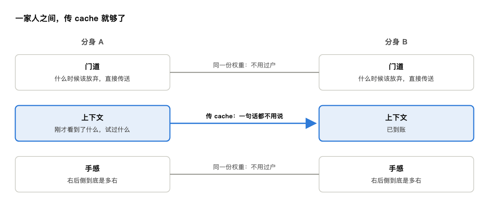

# 浅入浅出&lt;Language as Cash&gt;

Oct 12, 2026

> Claude 起草，GPT 改写，作者润色

开宗明义。本文始于一个观察：我把自己做原神日常的录屏和操作记录交给了 agent，它能把每一步讲明白，却还不能稳定替我做。为什么一个比解 NS 方程容易一百万倍的事情，agent 还学不会？顺着这个落差往下想，问题反而调了个头：人教 agent 要靠语言，那 agent 和 agent 之间呢？由此得到本文的两个暴论：(1) 语言是人类为“脑子不能复制”交的税；(2) agent 的分身之间本可以免税，今天的 multi-agent 却在一家人之间当面点钞。

## 故事一：看得懂，做不到 Knowing-doing Gap

最近又原神启动了：想让 agent 替我做原神日常。每天几个小任务，打怪、跑腿、帮 NPC 找东西，本来是下班之后的娱乐，做久了就成了下班之后的第二份工。既然连写代码都能交给 agent 了，这事难道不应该外包？

我的教法堪称慷慨：把自己做日常的全过程录了屏，同时录下每一步操作，一起交给 agent。攻略里的“从左边绕过去”这种话，写的人省了字，读的人得自己脑补；这次我把走过的路和点过的每一下都交了出去，自以为已经从口头传授升级成了手把手教学。

agent 看完，表现得像一个认真听讲的好学生。它能说出我每一步在干什么：这里是开地图传送，这里是在找委托点，这里是先清怪再交任务。连整体思路，都总结得比我本人有条理。

然后我让它自己来。实操是在手机上：我把 Codex 接到自己写的控制工具上，让它看实时屏幕，再通过工具点击、滑动和长按。为了免得它乱花我的家底，我还要求它先讲打算怎么做，得到我同意再动手。原本想雇个代练，最后给自己找了个需要带教的实习生。

它能打开地图，找到委托，传送过去，切出钟离开盾。然后卡在了找怪：它看见远处有一群怪，就朝那边走，走一段，截图，判断，再走一段。问题是，那群怪并不是这次委托要找的。我终于忍不住提醒：“日常任务的怪应该在你现在的右后侧。”至冬天寒地冻，有个温暖度条。它停下来分析，角色也停下来等；角色愿意等，温暖度不愿意。等它重新调整好方向，温暖度从九成多掉到了零，任务进度还端端正正地停在 0/4。

锅当然不能全甩给模型：延迟、人工确认、我自己写的控制工具，哪样都能分走一半。但这套系统至少让我看清了一件事：“去那里，把那几只怪打掉”，讲明白了，未必就能做好。

那为什么一个会玩的人，看一遍就能上手？因为他早就交过另一笔学费了。怎么控镜头，怎么判断距离，走偏了怎么修正，这些本事已经在他身上，录像只需要告诉他这次用在哪。我以为自己递过去的是技能，实际递过去的，只是调用技能的说明。

按&lt;压缩即智能&gt;的标准，中文互联网早就贡献过一个压缩率满分的选手：“懂的都懂”。四个字，信息量为零，交接却经常成功，因为该懂的那部分，早就装在懂的人脑子里了。不懂的人，再读一百遍也还是四个字。

不信可以试试：“钟离开盾，万叶聚怪，雷神开大。”原神玩家读到这里，脑子里已经放完了一套连招；没玩过的，看到的只是三个人名，外加三个不知所云的动作。

**一句话省下来的字，往往是接收者以前交过的学费。**

语言像现金的地方，正在这里。它容易携带，容易组合，也容易转手，而且不记名，不挑收款人：我把一句话交给你，不必知道你脑子里具体怎么实现。大家不必长着同一个脑子，也能一起干活。Language as Cash：值钱在流动性，不在面额。

拿原神画成图，大概是这样：

语言在中间流通，也向两头延伸。暂时交接不了的部分，有点像不动产：值钱，但揣不进兜里。想转手，得办过户。

现金当然是好东西。但请先记住两件事：有些东西现金买不到；以及，有些场合根本用不着现金。

## 故事二：人得过户，模型能复制 Cashing Out

原神玩家都懂一个道理：作业可以抄，手法抄不走。所以说不清的手法，就一定贵？

不一定。什么是猫，没人写得出一份说明书；围棋高手也说不清自己那鹰之一手妙在哪。可这两样，今天的模型都干得又好又便宜。

区别在于，模型掌握的本事可以直接复制。认猫学一次很贵，要海量图片，要大把算力；可一旦掌握，本事就存进了权重，复制一份模型，世上就多一个会认猫的。围棋更省事，棋盘是现成的，输赢一目了然，模型可以自己跟自己下，左右互搏几百万盘，学费自己变出来。学费只交一遍，之后每一份拷贝都近乎免费。

所以贵的从来不是“说不清”本身，而是把它从一个脑子搬进另一个脑子。<strong>说不清的知识，贵在过户。</strong>

原神就是一次过户失败。那套本事明明在我身上，学费早就交过了，我却没有办法把它递给模型。我能等它把道理想明白，温暖度条不能。

上一篇的毛病是贷款批得太痛快，这一篇的毛病是批下来之后，过户系统维护中。银行的两种事故，agent 一家全占了。

人往模型过户这么难，模型往模型呢？直接拷贝就行，只是拷贝也挑对象。权重只在差不多的架构、差不多的身体之间通用，换个模型、换台机器人，往往又得重新适配；你以为买到的是通用技能，到手才发现是卖家秀。语言不挑：一句话，人能接，模型也能接。现金能在所有人之间流通，不动产只能在同一个户籍系统里过户。

可要是在同一个户籍里呢？一家人之间本来就不用现金。你帮我带饭，我帮你取快递，没人当场结账。现金是陌生人社会的发明：彼此不知根底，只好拿一张谁都认的纸来交易。同一个模型的拷贝之间就是一家人，本事直接复制，一句都不用教。人和人之间才需要语言，因为脑子没法拷贝。<strong>语言是人类为“脑子不能复制”交的税。</strong>

## 故事三：一家人当面点钞 Paying Tax to Yourself

人类交了几千年的语言税，如今多了一台印钞机：LLM。以前，能把一件事讲清楚的人，大概率真熬过夜：没熬过的，写到第三段就露馅了。所以一份条理清楚的解释，顺带证明了这个人下过功夫。现在随手就能印出一段结构完整、术语准确、语气从容的文字，它可能来自一位熬了十年的专家，也可能来自一个周会前五分钟才打开文档的人。

(本文的署名行就是现场证据。)

更妙的是，新印的钱经常只是在空转。我用模型把三句话扩写成一封得体的邮件，对方用模型把邮件总结回三句话。到了 multi-agent，这件事连人都省了：planner 写一份计划，executor 读完写一份进度，reviewer 读完写一份意见，planner 再读完改一版计划。每一轮都是几千 token 的漂亮文字，账面上热火朝天，任务进度还端端正正地停在 0/4。钱在几台印钞机之间转了一圈又一圈，GDP 涨了，事情没动。

症状说完，回到上一节那笔税：agent 本来不用交。同一个模型开十个分身，本事不用重新教；刚才各自看见了什么、想到了哪一步，总还得交代。问题是，这也非得写成工作汇报吗？今天 multi-agent 的答案是：非写不可。分身之间开会用的还是自然语言，彼此客客气气，像刚加上微信的同事。一家人，非要当面点钞。

而这些，本来就以 cache 的形式躺在显存里。何况写工作汇报，还容易把犹豫写没了：分身 A 原本只是觉得“大概在右后侧”，到了纪要里，就成了“目标在右后侧”。上一篇说写下即凝固；分身之间每传一次话，就可能再凝固一次。已经有工作在试着跳过“写成文字、再读回来”这一趟：例如 LatentMAS 让多个 agent 直接在隐空间里协作，彼此传的是隐状态和 KV cache，而不是一段段文字。一家人之间，传 cache 就够了，用不着掏 cash。

但先别急着把文字完全省掉：agent 之间不说人话，人还怎么查账？上一篇刚主张把假设、证据和依赖都写进 hypothesis ledger，这一篇就要把账本撕了？

这个问题正好把话说完整。一家人之间不用现金，可家里照样要记账：不是为了彼此结算，是为了给外人看，给税务局看，给将来的自己看。agent 也一样。分身之间传 cache，效率归效率；给人看的那本账，还得用人话记。<strong>语言不必再是 agent 之间的通货，但仍然是它们给人看的记账本。</strong>当然，账本得对得上实际操作。否则里面进度还是 0/4，外面纪要已经写成了“进展顺利”，账还是没法查。

今天的 multi-agent 把这两件事混成了一件：用同一份文字，既当家里的转账，又当对外的账本。结果是转账慢，账本还乱，一轮轮会议纪要，人看不完，agent 也用不着。上一篇说，记账的和花钱的要分开；这一篇再补半句：转账的和记账的，也该分开。

## 尾声

上一篇用论语结的尾，这一篇轮到老子：道可道，非常道。前半句是现金，后半句是不动产。

较真的读者此刻又该抗议了：语言不是货币，分身也未必算一家人，实验还是 pass@1，而且没 pass。没错。把本文当成严格的货币理论，属于对我的会计水平寄予了不切实际的厚望；恬不知耻地夸大宣传，仍然是本系列的保留节目。

上一篇自称资深打油诗人，不是玩笑。写完这篇才反应过来：人类最心甘情愿多交语言税的地方，大概就是写诗。不为省事，为的是那段经历里只能这样说的部分：某个字，某种节奏，换一种说法就不是它了。在一个越来越擅长生产“大意如此”的年代，我在给自己印一张不太好找零的大钞。

这当然不保证它真的值钱。只是我舍不得把它换成零钱。

上一篇欠的那笔“长期记忆的债”，本篇没还，只是从负债聊到了现金，又从现金聊到了 cache。agent 攒下的 cache 里，该记住的是走通的路，还是走错之后怎么回来？那是下一篇的事了。

悲观者永远正确，乐观者永远乐观。下期见！
