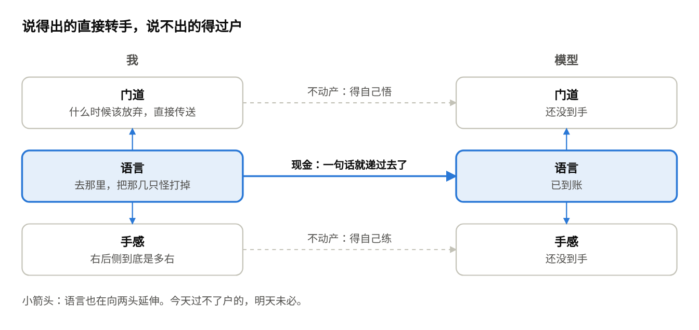

# 浅入浅出&lt;Language as Cash&gt;

> Claude 起草，GPT 改写，作者润色

开宗明义。本文始于一个观察：我把自己做原神日常的录屏和操作记录交给了 agent，它能把每一步讲明白，却还不能稳定替我做。为什么一个比解 NS 方程容易一百万倍的事情，agent 还学不会？顺着这个落差，得到本文的两个暴论：(1) 无法用语言高效描述的知识，一定昂贵；(2) 能用语言高效描述的知识正在通胀，LLM 就是那台印钞机。

## 故事一：看得懂，做不到 The Price Tag

最近又原神启动了：想让 agent 替我做原神日常。每天几个小任务，打怪、跑腿、帮 NPC 找东西，本来是下班之后的娱乐，做久了就成了下班之后的第二份工。既然连写代码都能交给 agent 了，这事难道不应该外包？

我的教法堪称慷慨：把自己做日常的全过程录了屏，同时录下每一步操作，一起交给 agent。这次没有只给攻略。攻略里的“从左边绕过去”这种话，写的人省了字，读的人得自己脑补。我把走过的路和点过的每一下都交了出去，自以为已经从口头传授升级成了手把手教学。

agent 看完，表现得像一个认真听讲的好学生。它能说出我每一步在干什么：这里是开地图传送，这里是在找委托点，这里是先清怪再交任务。连整体思路，都总结得比我本人有条理。

然后我让它自己来。实操是在手机上。我把 Codex 接到自己写的控制工具上，让它看实时屏幕，再通过工具点击、滑动和长按。为了免得它乱花我的家底，我还要求它先讲打算怎么做，得到我同意再动手。原本想雇个代练，最后给自己找了个需要带教的实习生。

开头倒也不是寸步难行。它能打开地图，找到委托，传送过去，切出钟离开盾。我连后面的打法都交代好了，结果连招没用上，先卡在了找怪。

它看见远处有一群怪，就朝那边走。走一段，截图，判断，再走一段。问题是，那群怪并不是这次委托要找的。我在旁边看了一会儿，终于忍不住提醒：“你怎么一直往前跑，日常任务的怪应该在你现在的右后侧。”

更尴尬的是，至冬这天寒地冻的，有个温暖度条。它停下来分析，角色也停下来等；角色愿意等，温暖度不愿意。等它重新看地图、调整方向，温暖度已经从九成多掉到了零，任务进度还端端正正地停在 0/4。我们只好叫停。

锅当然不能全甩给模型。截图和工具往返有延迟，我要求的人工确认也增加了等待，控制工具还是我自己写的。它甚至没真正打起来，我们就已经停了下来。但这套系统至少让我看清了一件事：“去那里，把那几只怪打掉”，讲明白了，未必就能做好。

那为什么一个会玩的人，看一遍就能上手？因为他早就交过另一笔学费了。怎么控镜头，怎么判断距离，走偏了怎么修正，这些本事已经在他身上，录像只需要告诉他这次用在哪。我以为自己递过去的是技能，实际递过去的，只是调用技能的说明。

这让我重新琢磨了一下：语言到底替我们省了什么？

按&lt;压缩即智能&gt;的标准，中文互联网早就贡献过一个压缩率满分的选手：“懂的都懂”。四个字，信息量为零，交接却经常成功，因为该懂的那部分，早就装在懂的人脑子里了。不懂的人，再读一百遍也还是四个字。

**一句话省下来的字，往往是接收者以前交过的学费。**

“去蒙德城交任务”也一样。七个字，没有操作序列，也没有绕路方案，只把目标交给你，沿途的判断全留给你：既压缩了决策空间，又留了容错。

语言像现金的地方，正在这里。它容易携带，容易组合，也容易转手，而且不记名，不挑收款人：我把一句话交给你，不必知道你脑子里具体怎么实现。大家不必长着同一个脑子，也能一起干活。

Language as Cash：值钱在流动性，不在面额。

拿原神画成图，大概是这样：

语言在中间流通，也向两头延伸。暂时交接不了的部分，有点像不动产：值钱，但过户的手续比递一张钞票麻烦得多。

现金当然是好东西。但请先记住两件事：有些东西现金买不到，以及，现金是会贬值的。

## 故事二：说不清的都很贵 Cashing Out

先把暴论一摆出来：

**无法用语言高效描述的知识，一定昂贵。**

原神玩家都懂这个道理：作业可以抄，手法抄不走。

上一篇说的是“绑定”：agent 太容易把“大概如此”当成“就这么干”。这一篇再往后走一步：就算它决定干了，能不能干成？上一篇的毛病是贷款批得太痛快，这一篇的毛病是批下来之后发现系统维护中。银行的两种事故，agent 一家全占了。

“去蒙德城交任务”，会玩的人能兑成一串因地制宜的动作。我搭的 agent 念得出票面上写了什么，却兑不出来。<strong>解说词的质量，不能直接推出执行能力。</strong>

那么，说不清的本事真的都很贵吗？写到这里，暴论一得先挨自己一刀：什么是猫，没人写得出一份说明书；围棋高手也说不清自己那鹰之一手妙在哪。可这两样，今天的模型都干得又好又便宜。

区别在于，模型掌握的本事可以直接复制。认猫学一次很贵，要海量图片，要大把算力；可一旦掌握，本事就存进了权重，复制一份模型，世上就多一个会认猫的。围棋更省事，连图片都不用攒：棋盘是现成的，输赢一目了然，模型可以自己跟自己下，左右互搏几百万盘，学费自己变出来。人做不到这些：眼睛会了手不会，大佬的手法你只能自己练。

模型的复制挑对象。权重只在差不多的架构、差不多的身体之间通用，换个模型、换台机器人，往往又得重新适配；你以为买到的是通用技能，到手才发现是卖家秀。语言不挑：一句话，人能接，模型也能接。这才是现金的本事。

所以暴论一得改一改。我的假设是：<strong>说不清的知识，贵在过户。</strong>自己掌握未必最贵，贵的是让别人也完整掌握。

原神就是一次过户失败。那套本事明明在我身上，学费早就交过了，我却没有办法把它递给模型。我能等它把道理想明白，温暖度条不能。

机器人是同一件事的放大版。叠衣服、做饭，几十亿人都会，却没有一个人能把它直接过户给机器。做饭的视频网上要多少有多少，可普通视频不会附带机器人要的关节状态和接触力。过不了户，机器就只能自己重新学：模拟器算不准现实里的摩擦和意外；现实环境倒是最诚实，碰坏一个杯子，它就真的少一个杯子。

这个方向上有意思的进展，都在想办法把这笔学费降下来：从没有动作标签的视频里学出一套“隐动作”；或者把语言往动作那边再推一层，直接说“手臂前移”。但起名字不会凭空生出技能。API 也是这个道理：好名字让操作容易理解，容易调用，但名字背后总得有人把函数实现好。

## 故事三：说得清的在贬值 The Printing Press

暴论二是暴论一的镜像：

**能用语言高效描述的知识正在通胀，LLM 就是那台印钞机。**

以前，能把一件事讲清楚的人，大概率真熬过夜：没熬过的，写到第三段就露馅了。所以一份条理清楚的解释，顺带证明了这个人下过功夫。现在几秒钟就能印出一段结构完整、术语准确、语气从容的文字，它可能来自一位熬了十年的专家，也可能来自一个周会前五分钟才打开文档的人。

(本文的署名行就是通胀的现场证据。)

所以这台印钞机，其实一口气让两样东西贬了值。一样是“我知道”：以前要请教专家才讲得清的事，现在问一句就有，光靠知道得多吃饭的人，手里的存货不那么稀罕了。另一样是“我讲得清”：文章写得漂亮，已经说明不了作者真懂。以前可以凭文笔认人，现在最多认得出他用的是哪家模型。

&lt;Intelligence is a Double Helix&gt;里说，模型每完整掌握一层能力，人就被推上一级抽象阶梯。只掌握了一半，就是楼下还没打牢地基，楼上已经开始装修。

不过，哪些能力能被完整掌握，边界并不固定。人自己说不清的经验，只要留下了记录，模型有时反而能替他提炼出来。动作也一样，只是痕迹更难采：我的录像只留下了做对的那条路，走错之后怎么回来，记录里没有。真正难过户的，可能恰恰是这一部分。

所以我愿意赌的是这个：<strong>最贵的，是自我纠错的能力。</strong>我那位实习生一路朝错的怪走，截图一直在更新，方向却没有，这就是 confirmation bias。

人也一样。给自己找一门说不清的本事，就宣布职业护城河竣工，也是一种 confirmation bias：今天的不动产，明天也可能找到新的过户方式。

问题因此变得具体：你那门本事的价值，到底来自哪里？是能把已有的知识组织成一篇文章，还是能在真实环境里把事情做成，出了岔子再把它救回来？

这些以前经常由同一个人打包出售。现在，买家开始能逐项询价了。

## 尾声

上一篇用论语结的尾，这一篇轮到老子：道可道，非常道。前半句是流动性，后半句是不动产。

较真的读者此刻又该抗议了：语言不是货币，文字变多不等于通胀，实验还是 pass@1，而且没 pass。没错。把本文当成严格的定价理论，属于对我的会计水平寄予了不切实际的厚望；恬不知耻地夸大宣传，仍然是本系列的保留节目。

上一篇自称资深打油诗人，不是玩笑。我一直以为写诗是在压缩，把一段经历压进几行字；写完这篇才反应过来，我想要的可能从来不是压缩，而是变得昂贵。在一个越来越擅长生产“大意如此”的年代，我在给自己印一张不太好找零的大钞。

这当然不保证它真的值钱。只是我舍不得把它换成零钱。

上一篇欠的那笔“长期记忆的债”，本篇没还，只是从负债聊到了现金。好在 cash 和 cache 同音：agent 攒下的经验里，该记住的是走通的路，还是走错之后怎么回来？那是下一篇的事了。

悲观者永远正确，乐观者永远乐观。下期见！
